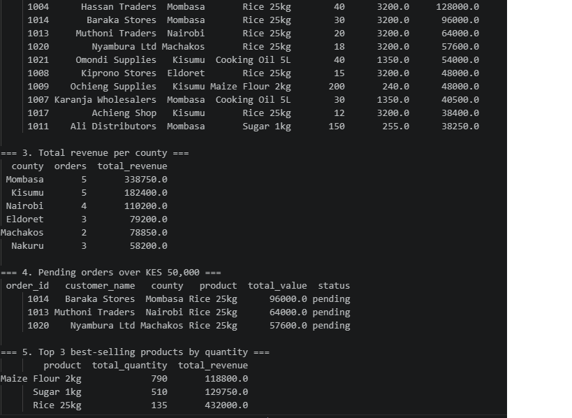

## Pricing for a Distributor

**Setup fee: KES 35,000 one-time**
- Build database
- Clean Excel data
- Create 5 Monday reports
- Train staff

**Monthly support: KES 10,000 / month**
- Fix errors
- Add new reports
- Monthly check-in
- Keep data backed up

Why separate? Setup is building it once. Support is keeping it running.


README
# Nairobi Wholesale Distributor - Monday Report



Replaces 45 minutes of manual Excel work with one Python + SQL script.

## What it does
Uses SQLite + pandas to answer the 5 questions the Sales Manager asks every Monday.

### Database: distributor.db
Table: `orders`
- order_id, customer_name, county, product, quantity, unit_price, order_date, status
- 22 realistic orders
- Total value is calculated as: `quantity * unit_price`

### 5 Questions Answered
1. All orders from Mombasa
2. Top 10 orders by total value
3. Total revenue per county
4. All pending orders over KES 50,000
5. Top 3 best-selling products by quantity

### Key Results
- Top county by revenue: Mombasa - KES 338,750
- Top product by value: Rice 25kg
- Top product by quantity: Maize Flour 2kg
- Urgent follow-ups: 3 pending orders over KES 50,000

## How to run
```bash
python today_exercise.py


